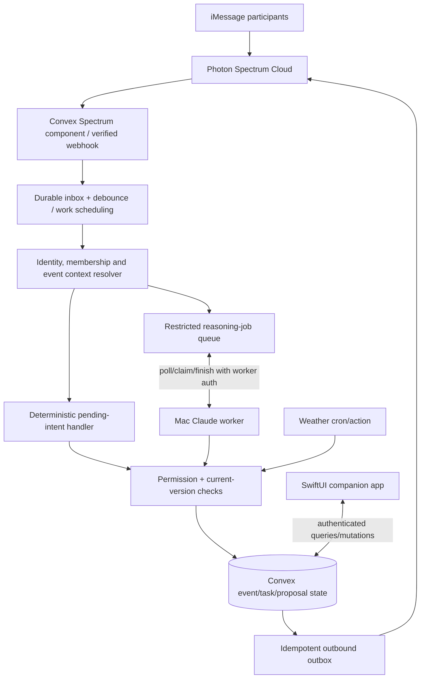

# System architecture and ownership

## Recommended deployment

## Authority boundaries

- **Photon component**: transport and validated ingress; do not assume the iMessage sender is a logged-in app user until the phone has been linked/verified.
- **Convex**: canonical event state, membership, permissions, transitions, outbox, reasoning jobs, audit logs, safe timers. Only Convex mutations commit changes.
- **Worker**: proposes `AgentDecision` records. It is **not** allowed to mutate arbitrary rows or send arbitrary iMessages directly.
- **SwiftUI**: privileged actions only after explicit authenticated identity and role checks; no secret keys in client app.
- **Integrations**: external observations enter as versioned evidence and proposed actions, not direct plan modifications.

## Write transaction semantics

1. Normalize and persist one inbound message by stable provider ID.
2. For an established pending proposal, try deterministic response parsing first.
3. Otherwise retrieve minimal scoped context and queue a worker job.
4. Validate worker results against action schema and actual database IDs.
5. If an action is consequential, create a proposal and necessary approval requests; do **not** commit yet.
6. On the right authenticated participant's acceptance, re-read event version/permissions; commit atomically and write audit entry/outbox entries.
7. Deliver via Photon and record attempted/success/failure states; distinguish transport acceptance from delivery/read receipts.

## Reasoning jobs / Mac availability

Design a worker **pull** loop (e.g. 1–3-second backoff-based polling) so the Mac needs outbound internet only. Each job stores `{status, createdAt, claimUntil, attempts, owner, contextVersion}`. An authenticated claim mutation acquires an unclaimed or expired job atomically, with a lease, and returns a minimized context packet. A completion endpoint enforces job owner token/lease, event version, schema and idempotency; expired jobs can be reissued at most N times.

**Authentication:** use a dedicated worker secret in environment configuration, server-verified on every claim/completion. Never expose that token to SwiftUI; prefer a short-lived signed worker session if implementation time permits. External callers must never be able to invoke internal Convex mutations by guessing IDs.

Worker queue does not guarantee low latency. For slow interpretation, send one truthful acknowledgement such as “I’m checking the assignments; I’ll follow up” and only claim completion after actual state updates. Do not send “done” speculatively.

## Event context resolver

Order of evidence: pending action scoped to exact sender → explicit event name/ID → recent event focus scoped to member → matching relevant tasks/mentions → temporal proximity. Return `{selectedEventId | null, candidateIds, requiresClarification, reasonCodes}`. Never use global events to resolve one user's private message.

## Outbox and retry

One unique business action → one outbox logical send. Record `pending/sending/sent/failed` and external message ID (when exposed). Retried jobs must reuse the same outbox key. Sending is an external side effect; perfect exactly-once delivery cannot be guaranteed without provider support—aim for **idempotent intent + deduplicated attempts**, and reconcile unknown outcomes before retrying.

## Observability

Emit structured events `inbound_received`, `event_resolved`, `clarification_requested`, `reasoning_job_started`, `proposal_created`, `message_send_attempted`, `approval_received`, `task_committed`, `worker_unavailable`, `weather_triggered`. Redact message bodies/secrets by default; use sanitized sample traces for judges.

## If the official Spectrum Convex component conflicts with custom jobs

Keep its durable ingress/outbound and implement Rally's domain work as internal scheduled actions/mutations. Validate cancellation/debounce semantics against package version to avoid accidentally dropping valid approval replies. Do not recreate raw webhook verification unless the component is unavailable.
